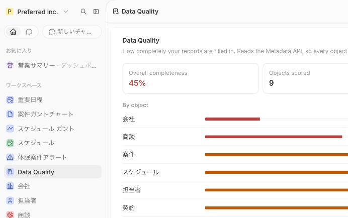
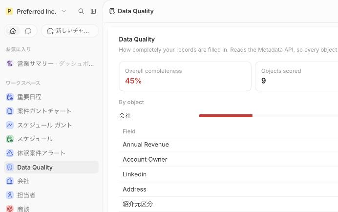

# Data Quality — a Twenty app

[](https://github.com/preferred-inc/twenty-data-quality/actions/workflows/ci.yml)
[](LICENSE)

Scores how completely the records in your [Twenty](https://twenty.com) workspace are filled in, worst first.

**Zero configuration.** It reads the Metadata API at runtime, so every object and field in *your*
workspace is picked up automatically — including custom ones. There is no list of fields to maintain.

**Read-only.** The role it ships with grants read access and nothing else. It never writes, deletes,
or changes settings.



## What it shows

- **Overall completeness** — weighted by how many values each object actually contributes, so an
  object with 3 records cannot swing the score as hard as one with 500
- **Per object** — a bar per object, sorted worst first, expandable into a per-field breakdown
- **Worst fields across the workspace** — the ten fields most likely to be worth a bulk fix

Expanding an object breaks it down field by field, worst first:



*(Screenshots are from a Japanese production workspace — object and field labels come from your
workspace, so the app speaks whatever language your Twenty does.)*

## What it does *not* score, and why

Getting this wrong is what makes a naive completeness score useless:

| Excluded | Why |
|---|---|
| `BOOLEAN` fields | `false` is a real answer. There is no way to tell it apart from "never set". |
| One-to-many relations | A company with no notes is not a defect, it is a company with no notes. |
| System fields (`id`, `createdAt`, `position`, `searchVector`, actors …) | Twenty manages them; a human never fills them in. |
| `name` | Effectively required, so it is always 100% and only dilutes the score. |

It also walks *into* composite fields. Twenty returns `CURRENCY`, `LINKS`, `EMAILS`, `PHONES`,
`ADDRESS`, `FULL_NAME` and rich text as objects whose sub-fields are present but null — so a plain
null check reports an empty currency field as filled. This does not:

```ts
isEmptyValue({ amountMicros: null, currencyCode: null }); // true
isEmptyValue({ amountMicros: 1_000_000, currencyCode: 'JPY' }); // false
```

Many-to-one relations are resolved through their `<name>Id` key, which is what the REST API returns.

## Install

```bash
nvm use            # Node ^24.5.0
yarn install
yarn twenty remote:add <name> --url https://your-twenty.example.com --api-key <key>
yarn twenty apply -f
```

The app appears in the navigation as **Data Quality**.

## Development

```bash
yarn test:unit     # scoring rules — no server needed
yarn test          # integration tests — needs a Twenty instance
yarn typecheck
yarn lint
```

The code is split so that both halves are testable:

- [`src/lib/quality.ts`](src/lib/quality.ts) — the scoring rules, as pure functions with no I/O.
  Covered by unit tests without a running Twenty instance.
- [`src/lib/workspace.ts`](src/lib/workspace.ts) — everything that talks to Twenty. Covered by
  integration tests that run against a real instance in CI, so an upstream schema change fails
  the build rather than a user's browser.

For integration tests locally, start a server first with `yarn twenty docker:start`.

## Sampling

Up to 200 records per object are read. On larger workspaces the score is a sample rather than a
census — accurate enough to rank fields, not a compliance report.

## License

MIT © Preferred Inc.
